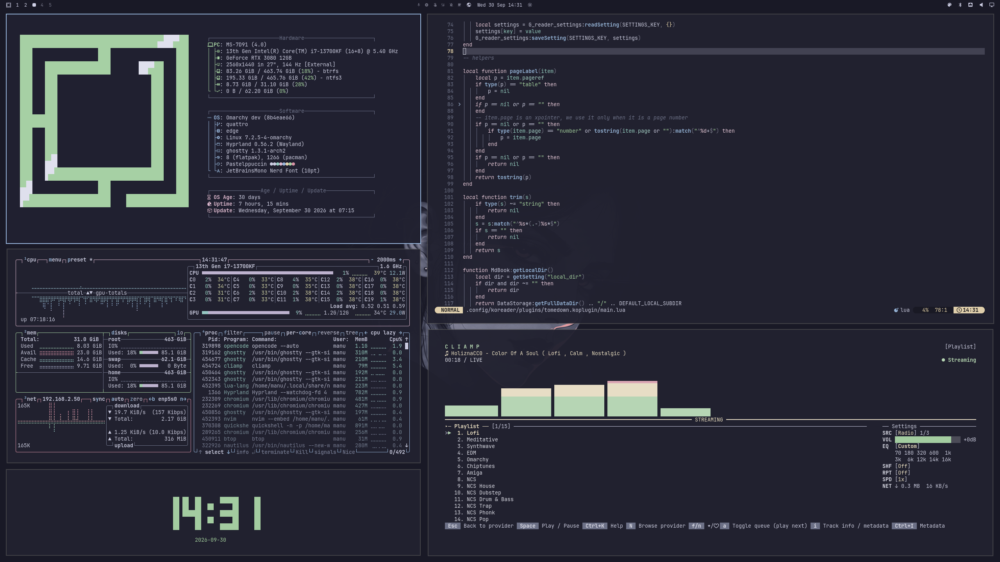
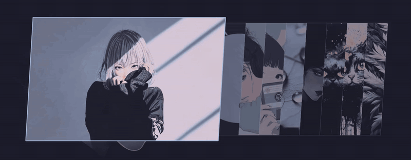
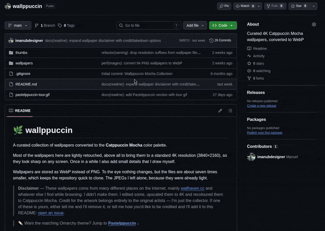

<div align="center">

# 🍡 Pastelppuccin

**Catppuccin Mocha, softened.**  
A dusty-pastel Omarchy theme: ink-blue backgrounds, lavender text, and colors drawn straight from its wallpapers.

[](https://omarchy.org)
[](https://github.com/catppuccin/catppuccin)
[](#-palette)
[-%239bd0c7?style=for-the-badge)](https://github.com/imanubdesigner/wallppuccin)
[](LICENSE)
[](https://github.com/imanubdesigner/omarchy-pastelppuccin-theme/stargazers)

</div>

<br>

<p align="center">
  
</p>

> **Wallpapers & copyright** — The artwork in this repository is not covered by the MIT license. Most images come from public wallpaper sites, mainly [wallhaven.cc](https://wallhaven.cc), and remain the property of their original authors. If one of them is yours and you'd rather it weren't here, [open an issue](../../issues) and I'll remove it immediately.

---

## 🚀 Installation

Install directly via the Omarchy CLI:

```bash
omarchy theme install https://github.com/imanubdesigner/omarchy-pastelppuccin-theme
```

Then select **Pastelppuccin** from *Style > Theme* in the Omarchy menu.

---

## 🖼️ Included Wallpapers

These are the handpicked wallpapers included with the theme — drop them into `~/.config/omarchy/backgrounds/`.

<p align="center">
  
</p>

---

## 🌿 Wallppuccin | The Official Wallpaper Companion

Looking for more wallpapers designed in the exact same spirit? **[Wallppuccin](https://github.com/imanubdesigner/wallppuccin)** is the dedicated wallpaper collection created to pair seamlessly with this theme.

Every shade in Pastelppuccin's `colors.toml` was carefully sampled and balanced against this collection of **213+ 4K wallpapers**:

- 🎨 **Tuned with PhotoCraft:** Recolored to soft, harmonious Catppuccin Mocha tones.
- 🖌️ **Hand-Retouched Details:** Subtle custom drawings, enhanced lighting, and touch-ups.
- 📐 **4K Standard (3840×2160):** Ultra-sharp across high-DPI displays.

<p align="center">
  <a href="https://github.com/imanubdesigner/wallppuccin">
    
  </a>
</p>

```bash
# Clone the complete collection straight into your wallpapers folder
git clone https://github.com/imanubdesigner/wallppuccin.git ~/.config/omarchy/backgrounds/wallppuccin
```

---

## 🎨 Palette

Everything is generated from a single `colors.toml`. It preserves the structure of Catppuccin Mocha, with softer saturation and hues matched to the wallpapers.

| Preview                                                     | Name              | Role / ANSI                   | Hex       |
|:-----------------------------------------------------------:|:----------------- |:----------------------------- |:--------- |
|  | **Background**    | Primary background (Ink-Blue) | `#212130` |
|  | **Foreground**    | Primary text / Lavender       | `#cfd0e6` |
|  | **Accent / Blue** | UI Accent / ANSI 4            | `#9bb9de` |
|  | **Mauve**         | Selection Background          | `#c4b8d6` |
|  | **Pink**          | ANSI 5                        | `#e0bdd3` |
|  | **Red**           | ANSI 1                        | `#dc96aa` |
|  | **Yellow**        | ANSI 3                        | `#e7d6b1` |
|  | **Green**         | ANSI 2                        | `#a9d3a6` |
|  | **Teal**          | ANSI 6                        | `#9bd0c7` |
|  | **Surface**       | Dark Gray / ANSI 0            | `#45475a` |

Icons use **Yaru-purple**.

---

## 🔗 Credits

- Palette inspired by [Catppuccin](https://github.com/catppuccin/catppuccin).
- Wallpaper artwork from [Wallhaven](https://wallhaven.cc), recolored to fit.
- Built for [Omarchy](https://omarchy.org).

No license is granted for the wallpaper images: they remain the property of their authors. Takedown requests: [open an issue](../../issues).

Released under the [MIT License](LICENSE). The license covers the theme's code and configuration only, not the images.

---

<div align="center">

### ⭐ Support & Stargazers

If you enjoy using Pastelppuccin on your desktop, please consider leaving a **Star** ⭐!

</div>
